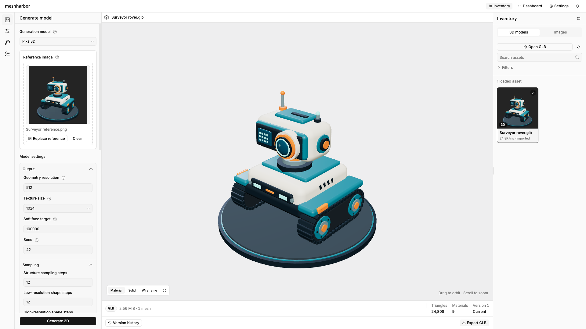

# MeshHarbor

[](LICENSE)
[](https://github.com/syi0808/meshharbor/actions/workflows/embedded-studio-package-smoke.yml)

**Generate 3D assets locally with open-weight models.**

MeshHarbor is a local-first alternative to [Tripo](https://www.tripo3d.ai/) and [Meshy](https://www.meshy.ai/) for 3D asset generation. After you set up a runtime and download its weights, generation runs on your hardware instead of sending inputs to a hosted service.

- **Generate with local models.** Studio manages installation for Pixal3D, TRELLIS.2, and TripoSG from images, or TRELLIS Text Large from prompts, on Apple Silicon (MLX) and Linux with NVIDIA (CUDA).
- **Refine and export GLBs.** Inspect, simplify, clean, or compress meshes. Compare revisions, download them, or send them to an open Blender scene without overwriting the original. Supported textured meshes can get a new UV atlas with a same-mesh rebake.
- **Work in Studio or automate locally.** Use the browser workbench, CLI, loopback REST API, or stdio MCP through the same Rust engine.



*The Studio generation screen with an imported example GLB.*

**Status:** Early source build, not feature parity with hosted services. No official installer, binary release, or bundled model weights. Some checkpoints require gated access and have separate usage terms. Mesh editing needs no Python or model setup. Generic high-to-low baking is not available. Experimental QuadriFlow retopology is available in an [opt-in linked build](docs/retopology-candidate.md#linked-development-build).

## Quick start

Unsigned builds for Windows, macOS, and Linux are available as opt-in [GitHub Actions CI artifacts](docs/embedded-studio-package-smoke.md#download-a-ci-build), not as official releases.

### From source

Install Rust/Cargo 1.88 or later and a C/C++ toolchain. The checkout includes the built Studio client, so you don't need Node.js, pnpm, or a separate frontend build to run it. See the [build and smoke guide](docs/embedded-studio-package-smoke.md) for additional Windows build requirements.

Clone the repository and start the local server:

```sh
git clone https://github.com/syi0808/meshharbor.git
cd meshharbor
cargo run --locked --bin meshharbor -- serve --listen 127.0.0.1:7432
```

Open **http://127.0.0.1:7432**. The server is single-user and loopback-only; do not expose it through a public proxy.

- **Generate a model:** Install a backend in **Settings → Models**. Once ready, open **New model**, provide its input, and click **Generate 3D**. Studio opens the inventory and selects the new card as it goes from queued to completed.
- **Try Studio without a model download:** Select **Inventory → 3D models → Open GLB**. Use **Optimize**, compare **Original** and **Result**, then **Export GLB**.

For the CLI, run `cargo run --locked --bin meshharbor -- --help`.

### Run the native binary in the background

Put the built `meshharbor` binary in a permanent location on `PATH`. On macOS, Linux with systemd, or Windows, run as your own user without elevation:

```sh
meshharbor service install
meshharbor service start
meshharbor service status
```

Studio and the REST API remain available at **http://127.0.0.1:7432** after you close the terminal. See the [CLI guide](docs/cli.md#background-service) for startup at login, Linux boot without login, and logs. To [remove the native installation and its data](docs/cli.md#uninstall-meshharbor), run `meshharbor uninstall` to preview what will be deleted.

### Docker

From the repository root, build and start MeshHarbor:

```sh
docker build -t meshharbor .
docker run --rm --init --network host --name meshharbor -v meshharbor-data:/data meshharbor
```

Open **http://127.0.0.1:7432**. The named volume keeps imported assets, jobs, and settings when the container is removed. Stop the container with `docker stop meshharbor`.

MeshHarbor still listens only on loopback, so use [host networking](https://docs.docker.com/engine/network/drivers/host/) rather than `-p`. On Docker Desktop 4.34 or later, enable **Settings → Resources → Network → Enable host networking**, then apply and restart. Do not expose Studio through a public proxy.

The image includes Studio, the API, and CPU mesh editing. It does not include GPU generation runtimes or model weights; use the native setup guides for MLX or CUDA generation.

### Send to Blender

1. In Studio, select a model version and click **Send to Blender** below the preview.
2. With Blender 4.2 or newer closed, click **Install locally**. MeshHarbor installs and enables its add-on for the next launch. If Blender is running, MeshHarbor leaves its settings untouched and asks you to quit Blender and retry.
3. Open Blender, press **N** in the 3D Viewport, and choose **MeshHarbor → Start Bridge**. Back in Studio, click **Send to Blender** again to add the model to the open scene without saving or replacing it.

The bridge works locally with both regular and MeshHarbor meshopt-compressed GLBs. The stored GLB stays unchanged, and the bridge packs embedded textures in Blender. You can also install the add-on and send models from the [CLI](docs/cli.md#send-to-blender) or [MCP](docs/mcp-workflow.md#send-to-blender) without a Studio tab. If automatic installation is unavailable or you're using Docker, follow the [manual add-on installation steps](apps/studio/README.md#send-a-model-to-blender).

## Documentation

| I want to… | Start here |
| --- | --- |
| Use Studio, version history, or job controls | [Studio guide](apps/studio/README.md) |
| Process assets from a terminal | [CLI guide](docs/cli.md) |
| Integrate with the local API or an MCP client | [REST API](docs/rest-api.md) · [Swagger UI on the running server](http://127.0.0.1:7432/docs) · [MCP workflow](docs/mcp-workflow.md) |
| Set up a generation model | [Pixal3D MLX](docs/pixal3d-mlx-manual-runtime.md) · [Pixal3D CUDA](docs/pixal3d-cuda-managed-runtime.md) · [TRELLIS.2 and TripoSG](docs/external-generation-runtimes.md) · TRELLIS Text [MLX](docs/trellis-text-mlx.md) / [CUDA](docs/trellis-text-cuda.md) |
| Understand format limits or work on the project | [Architecture](docs/architecture.md) · [Documentation index](docs/README.md) · [Contributing](CONTRIBUTING.md) |

## Contributing

[Issues and benchmarks](https://github.com/syi0808/meshharbor/issues) are welcome. Include the revision, platform, and a minimal shareable fixture when possible. Use the [contribution guide](CONTRIBUTING.md) for development checks and the [security policy](SECURITY.md) for private vulnerability reports.

## License

MeshHarbor's first-party code and documentation are licensed under the [Elastic License 2.0 (ELv2)](LICENSE). Under ELv2, you may run MeshHarbor for yourself or internally at your organization. You may not offer it to third parties as a hosted or managed service that exposes a substantial set of its features, whether free or paid. Examples include a hosted Studio instance and a service exposing the generation API.

ELv2 covers MeshHarbor itself, not the 3D assets you create with it. Check any terms that apply to your inputs and chosen models separately. Vendored code, bundled Studio dependencies, fonts, and model/runtime components retain their own terms; see the [third-party notices](THIRD-PARTY-NOTICES.md) and [licensing status](docs/licensing-status.md) before redistribution.
